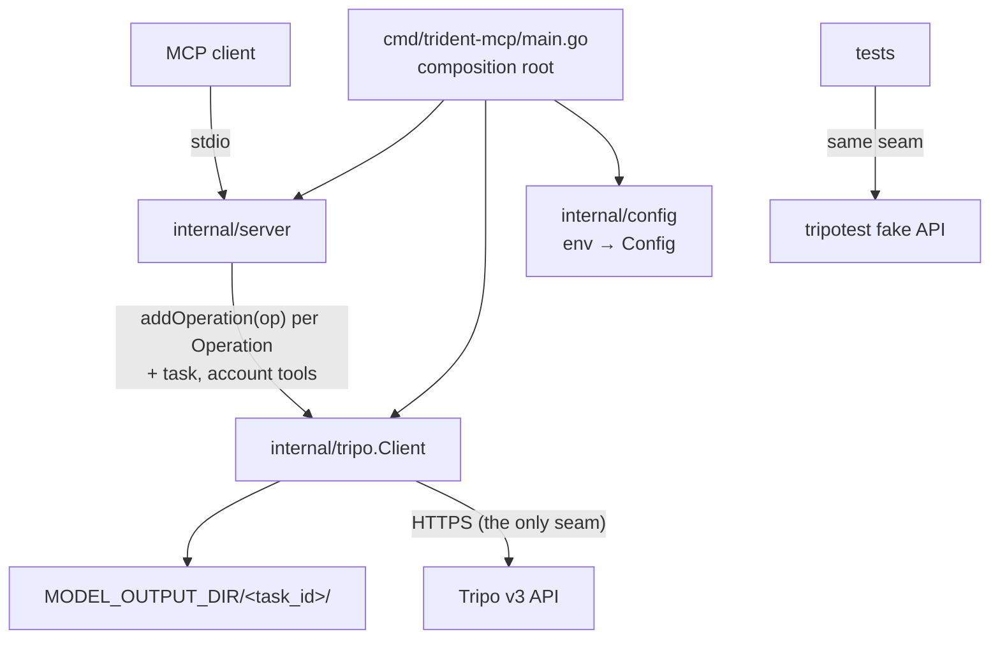
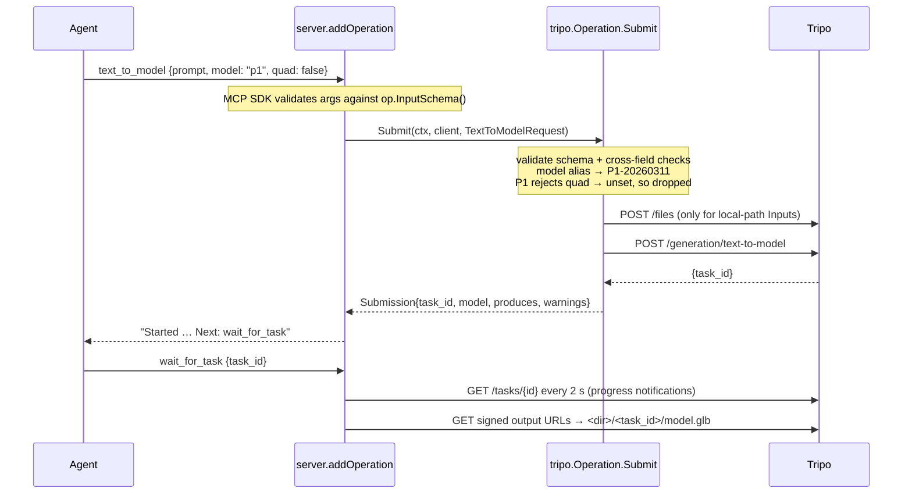

# Architecture

trident-mcp is a Go MCP server for the Tripo 3D API. All Tripo knowledge lives in one module, `internal/tripo`. The MCP server is a thin generic layer on top of it (ADR-0004).

Related documentation:

- [Tripo module design](docs/design/tripo-module.md): invariants and update rules
- [MCP tool reference](docs/MCP_TOOLS.md)
- [Glossary](GLOSSARY.md)
- [Architecture decision records](docs/adr/)
- [Threat model](THREAT_MODEL.md)

## Layout

| Path | Role |
| --- | --- |
| `cmd/trident-mcp/main.go` | Loads config, builds `tripo.Client`, builds and runs the server. |
| `internal/config` | Reads `TRIPO_API_KEY` (or the plugin's `TRIDENT_TRIPO_API_KEY`), `TRIPO_BASE_URL` and `MODEL_OUTPUT_DIR`. |
| `internal/tripo` | The Tripo module. See below. |
| `internal/tripo/tripotest` | An in-memory fake of the Tripo API: the second adapter behind the HTTP seam. |
| `internal/server` | MCP tools. Each Operation becomes a tool through one generic `addOperation`. Also the task, account and config tools. |
| `skills/` | Agent skills shipped with the Claude Code plugin. |

## The tripo module

| File | Owns |
| --- | --- |
| `client.go` | `Client`, the authenticated transport, the `{code, data}` envelope, `*tripo.Error` (code, message, suggestion, request ID), 429 retries |
| `operation.go` | `Operation[R]`: encode, validate, resolve the model version, upload Inputs, POST; schema generation from struct tags |
| `operations.go` | Every Operation and its request type: the full v3 task-creating surface |
| `catalog.go` | Model versions: aliases, per-Operation defaults, fields each version rejects |
| `input.go` | `Input` resolution (local path → upload → file token), multipart and presigned uploads |
| `task.go` | `Task`, `Status`, Output accessors, `GetTask`, `GetTasks`, `WaitTask` |
| `download.go` | `Download`: Outputs → Artifacts on disk, with format detection |
| `account.go` | Balance and usage |

### How one operation call flows

## Design choices

- **One adapter, so no Go-interface seam** (ADR-0004). The server depends on `*tripo.Client`. Tests swap the HTTP transport (`tripotest`), not Go types, so one test covers argument decoding, payload encoding and output parsing together.
- **Arguments mirror Tripo's field names** (ADR-0005). A request struct's `json` tags are the MCP schema and the Tripo payload at once, `enum` tags feed the schema and validation, and `catalog` tags resolve version fields. Adding a Tripo parameter means adding one field.
- **The catalog is static** (ADR-0002). It never calls Tripo for discovery. Unknown versions still go through with a warning, so new Tripo models work before the catalog is updated.
- **Tasks are asynchronous** (ADR-0003). Create tools never block. `wait_for_task` is the opt-in blocking step and saves outputs before their five-minute URLs expire.
- **Outputs are kept verbatim.** `Task.Output` is Tripo's map. Every `*_url` field, including nested ones, becomes a downloadable Artifact, so new output types need no code.

## Testing

| Layer | Through | Covers |
| --- | --- | --- |
| `internal/tripo` | public API against `tripotest` | payload per Operation, catalog rules, local validation, uploads, task decoding, waiting, downloads, error envelopes, retries |
| `internal/server` | in-memory MCP client → real `tripo.Client` → `tripotest` | the tool list, every Operation tool end to end, schema rejection, `wait_for_task` progress and downloads, docs coverage of every tool |
| `internal/tripo/e2e_test.go` | the live API (`-tags=e2e`) | free calls by default; `TRIPO_E2E_SPEND=1` runs a balance-gated lifecycle of about 80 credits |
